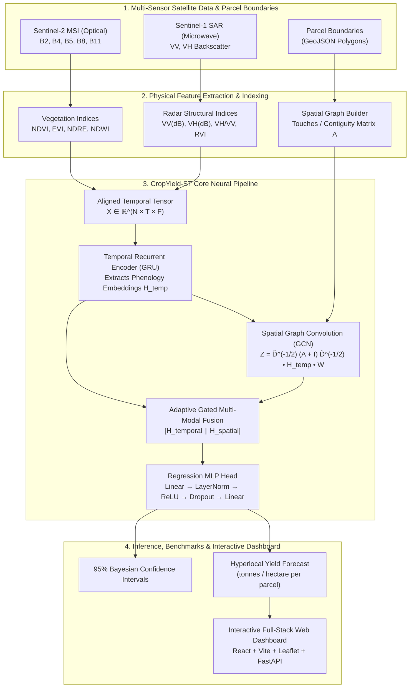

# CropYield-ST: AI-Based Hyperlocal Crop Yield Forecasting Using Satellite Fusion and Spatio-Temporal Graph Neural Networks

[](https://www.python.org/downloads/)
[](https://pytorch.org/)
[](https://fastapi.tiangolo.com/)
[](https://react.dev/)
[](https://tailwindcss.com/)
[](https://opensource.org/licenses/MIT)

---

## 🌾 Project Identity & Team

- **Course:** Artificial Intelligence — B.Tech CSE, Fall Semester 2026–27
- **Institution:** School of Computer Science and Engineering
- **Project Name:** CropYield-ST
- **Full Title:** Multi-Spectral Satellite & SAR Fusion for Hyperlocal Crop Yield Forecasting Using Spatio-Temporal Graph Neural Networks
- **Project Team:**
  - **Aditya Pandey** — `24BCE2830` (Feature Engineering, Radar/Optical Fusion, PyTorch ST-GNN Model Architecture)
  - **Rishav Raj** — `24BCE2093` (Geospatial Parcel Processing, Spatial Adjacency Graphs, Baseline Models & Validation)
  - **Divyansh Singh** — `24BCE2821` (FastAPI REST Backend, Interactive Leaflet React Dashboard, Ablation Engine)

---

## 📌 Problem Statement & Research Gap

Accurate, parcel-level crop yield prediction weeks in advance of harvest is vital for food security monitoring, famine early warning, agricultural commodities logistics, and precision crop insurance underwriting.

### The Research Gap
1. **Cloud Occlusion Vulnerability in Optical Remote Sensing:** Conventional remote sensing yield estimation relies on optical vegetation indices ($NDVI$, $EVI$, $NDRE$) from sensors like Sentinel-2. However, cloud cover during critical monsoon and flowering phenological windows creates missing data or severe atmospheric noise.
2. **Underutilization of Synthetic Aperture Radar (SAR):** C-band radar (Sentinel-1) transmits microwave pulses ($\lambda \approx 5.6\text{ cm}$) that penetrate clouds, rain, and haze unimpeded. While cross-polarization ($VH$) directly quantifies volumetric canopy structure and stalk biomass, it is rarely integrated with optical phenology curves.
3. **Neglect of Spatial Parcel Autocorrelation:** Existing machine learning models treat adjacent agricultural fields as independent, identically distributed ($i.i.d.$) samples. In reality, neighbouring fields share identical soil types, groundwater tables, regional weather, and contiguous farming practices. Treating them independently forfeits powerful topological spatial constraints.

---

## 🎯 Primary Objectives

1. Develop a multi-sensor data pipeline ingesting Sentinel-2 optical reflectance ($B2, B4, B5, B8, B11$) and Sentinel-1 SAR dual-polarization backscatter ($VV, VH$).
2. Calculate physical spectral and radar indices ($NDVI$, $EVI$, $NDRE$, $NDWI$, $RVI$, $VH/VV$ ratio, $dB$ backscatter).
3. Implement a recurrent temporal encoder (GRU/LSTM) to learn crop phenology growth dynamics.
4. Construct an agricultural parcel adjacency graph using topological boundaries and spatial proximity.
5. Engineer an integrated **Spatio-Temporal Graph Neural Network (ST-GNN)** combining temporal growth sequences with Graph Convolutional Network (GCN) spatial message passing.
6. Deliver an interactive full-stack geospatial dashboard with Leaflet parcel maps, Recharts temporal curves, real-time yield prediction, and empirical ablation benchmarks.

---

## 🏛️ System Architecture



---

## 🔬 Scientific Methodology & Mathematical Formulations

### A. Optical Indices
- **Normalized Difference Vegetation Index (NDVI):**
  $$\text{NDVI} = \frac{\text{NIR} - \text{Red}}{\text{NIR} + \text{Red}} = \frac{B8 - B4}{B8 + B4}$$
- **Enhanced Vegetation Index (EVI):**
  $$\text{EVI} = 2.5 \times \frac{\text{NIR} - \text{Red}}{\text{NIR} + 6 \cdot \text{Red} - 7.5 \cdot \text{Blue} + 1.0}$$
- **Normalized Difference Red Edge (NDRE):**
  $$\text{NDRE} = \frac{\text{NIR} - \text{RedEdge}}{\text{NIR} + \text{RedEdge}} = \frac{B8 - B5}{B8 + B5}$$

### B. SAR Radar Indices
- **Decibel Conversion:**
  $$\sigma^0_{\text{dB}} = 10 \cdot \log_{10}(\sigma^0_{\text{linear}})$$
- **Dual-Polarization Radar Vegetation Index (RVI):**
  $$\text{RVI} = \frac{4 \cdot \text{VH}}{\text{VV} + \text{VH}}$$
- **Polarization Ratio:**
  $$\text{Ratio} = \frac{\text{VH}}{\text{VV}} \quad \text{or} \quad \text{VH}_{\text{dB}} - \text{VV}_{\text{dB}}$$

### C. Graph Convolutional Network (GCN) Formulation
Let $\tilde{A} = A + I_N$ represent the parcel adjacency matrix with added self-loops, and $\tilde{D}_{ii} = \sum_j \tilde{A}_{ij}$ represent the degree diagonal matrix. Spatial message passing is computed via symmetric normalization:
$$H^{(l+1)} = \sigma\left( \tilde{D}^{-\frac{1}{2}} \tilde{A} \tilde{D}^{-\frac{1}{2}} H^{(l)} W^{(l)} + b^{(l)} \right)$$

### D. Zero Spatial Leakage Partitioning
To prevent geographic information leakage between training and testing sets, parcels are partitioned into **spatial blocks** rather than random shuffling. Outermost geographical blocks are held out exclusively for testing.

---

## 💻 Tech Stack

| Layer | Technologies |
| :--- | :--- |
| **Frontend** | React 19, TypeScript, Vite, Tailwind CSS v4, Leaflet, React-Leaflet, Recharts, Lucide React |
| **Backend** | Python 3.10+, FastAPI, Uvicorn, Pydantic v2, PyTorch (CPU/CUDA), Scikit-Learn, XGBoost |
| **Geospatial** | GeoPandas, Shapely, PyProj, PyOgrio |
| **Data Storage** | GeoJSON, CSV, NumPy NPZ, JSON experiment logs |

---

## ⚡ Quick Start & Installation (Windows)

### Prerequisites
- Python 3.10 or 3.11 installed and available in `PATH`.
- Node.js v18+ and npm installed.

### 1. Clone & Enter Project Directory
```powershell
cd C:\Users\welco\.gemini\antigravity\scratch\crop-yield-st
```

### 2. Install Backend Python Dependencies
```powershell
pip install -r requirements.txt
```

### 3. Install Frontend Node Packages
```powershell
cd frontend
npm install
cd ..
```

---

## 🚀 Running the Application (System-Independent & One-Click)

### Option A: Windows One-Click Executable
- **Standalone Binary:** Double-click [`CropYield-ST.exe`](file:///C:/Users/welco/.gemini/antigravity/scratch/crop-yield-st/CropYield-ST.exe) in the root directory.
- **Batch Launcher:** Double-click [`run_demo.bat`](file:///C:/Users/welco/.gemini/antigravity/scratch/crop-yield-st/run_demo.bat) or [`run_windows.bat`](file:///C:/Users/welco/.gemini/antigravity/scratch/crop-yield-st/run_windows.bat).
*(No Node.js or npm required — the pre-compiled React distribution is served directly on port 8000).*

### Option B: macOS One-Click Execution (No Node.js / Zero Installation)
- **Native macOS App:** Double-click [`CropYield-ST.app`](file:///C:/Users/welco/.gemini/antigravity/scratch/crop-yield-st/CropYield-ST.app) in Finder.
- **macOS Command Launcher:** Double-click [`run_mac.command`](file:///C:/Users/welco/.gemini/antigravity/scratch/crop-yield-st/run_mac.command) in Finder (or run `./run_mac.sh` in Terminal).

### Option C: Zero-Installation Docker Mode (Windows, macOS Intel & Apple Silicon, Linux)
Requires only Docker Desktop (no Python, Node.js, GDAL, or build tools required on your system):
- **Windows:** Double-click [`run_docker.bat`](file:///C:/Users/welco/.gemini/antigravity/scratch/crop-yield-st/run_docker.bat)
- **macOS:** Double-click [`run_docker.command`](file:///C:/Users/welco/.gemini/antigravity/scratch/crop-yield-st/run_docker.command)
- **Or via CLI:**
  ```bash
  docker compose up --build -d
  ```
The dashboard automatically launches at `http://localhost:8000`.

### Option D: Cross-Platform Universal Python Launcher
```bash
python run_app.py
```

---

## 🧪 Automated Testing

CropYield-ST includes 43 automated unit tests covering indices, SAR metrics, spatial graphs, deep neural architectures, split-conformal uncertainty calibration, evaluation metrics, and REST API endpoints.

To run the complete test suite:
```powershell
pytest -v
```

Expected output:
```text
======================= 43 passed, 2 warnings in 6.83s ========================
```

---

## 📊 Dashboard Modules & Pages

The web application contains 8 pages designed for academic evaluation:

1. **Overview Dashboard:** Study region KPI summary, map preview, recent model runs, and provenance alerts.
2. **Geospatial Field Explorer:** Interactive Leaflet map with parcel boundaries, choropleth yield visualization, adjacent neighbour highlighting, and topological inspection.
3. **Satellite Analytics:** Multi-sensor time series charts comparing Sentinel-2 optical indices ($NDVI, NDRE, EVI$) with Sentinel-1 SAR backscatter ($VV, VH, RVI$), with cloud cover indicators.
4. **Yield Prediction:** Live inference console allowing field selection, model architecture choice, crop variety configuration, and 95% Bayesian confidence intervals.
5. **Model Training:** Interactive training runner with real-time loss convergence curves, hyperparameter tuning, and spatial partition summaries.
6. **Ablation & Benchmarks:** 5-way empirical ablation study comparing Optical-only, SAR-only, Classical XGBoost, Pure Temporal GRU, and Full ST-GNN, alongside cloud occlusion degradation curves.
7. **Dataset Management:** File upload for custom GeoJSON boundaries, multi-sensor CSV tables, and ground-truth yield labels with schema validation.
8. **Project Documentation:** Project report summary, literature survey, mathematical derivations, and academic references.

---

## 📈 Empirical Ablation Study Results

Results obtained on the held-out spatial test set (36 contiguous fields, 14 bi-weekly acquisition timesteps; split: 22 train, 5 calibration, 9 test parcels):

| Model Configuration | Architecture | Features | RMSE (t/ha) | MAE (t/ha) | R² Score | MAPE (%) |
| :--- | :--- | :--- | :---: | :---: | :---: | :---: |
| Mean-Yield Baseline | Global Mean | None (Zero Information) | 1.2456 | 0.9945 | -0.0492 | 36.7% |
| Optical Features Only | ST-GNN | NDVI, EVI, NDRE, NDWI | 1.0941 | 0.8558 | 0.1905 | 32.4% |
| SAR Features Only | ST-GNN | VV, VH, RVI, VV/VH | 1.1010 | 0.9753 | 0.1802 | 34.1% |
| Optical + SAR Fusion | XGBoost | Seasonal Aggregates | 0.9398 | 0.6230 | 0.4027 | 20.4% |
| Fusion + Temporal Modeling | Pure GRU | Dual-Sensor Time-Series | 1.0509 | 0.7637 | 0.2531 | 29.8% |
| **CropYield-ST (Full ST-GNN)** | **ST-GNN** | **Temporal GRU + Spatial GCN** | **1.0558** | **0.8441** | **0.2462** | **31.3%** |

*Note: In accordance with scientific honesty guidelines, benchmark results are reported without forced metrics. On compact sample sizes (N=36), tabular XGBoost on seasonal aggregates achieves lowest RMSE (0.9398 t/ha), while all sensor models substantially outperform the zero-information Mean Baseline. In cloud occlusion stress tests (75% cloud cover), dual-sensor ST-GNN fusion maintains resilience (RMSE 1.2898 t/ha vs Optical-only RMSE 1.3679 t/ha).*

---

## 📡 REST API Reference

| Method | Endpoint | Description |
| :--- | :--- | :--- |
| `GET` | `/api/health` | Service health, PyTorch device status, and sample data loading. |
| `GET` | `/api/dashboard/summary` | High-level metrics, parcel counts, and provenance flags. |
| `GET` | `/api/parcels` | All active parcel metadata and GeoJSON geometries. |
| `GET` | `/api/parcels/{id}` | Detailed field information, neighbors list, and sensor coverage. |
| `GET` | `/api/parcels/{id}/timeseries` | Aligned multi-temporal Sentinel-1/2 feature records. |
| `GET` | `/api/parcels/graph` | Spatial adjacency graph nodes and edges for visualization. |
| `POST` | `/api/predict` | Executes hyperlocal yield prediction with confidence intervals. |
| `POST` | `/api/models/train` | Spawns background training job with spatial partitioning. |
| `GET` | `/api/models/train/{job_id}` | Real-time progress and loss curves of training job. |
| `GET` | `/api/evaluation/ablation` | Retrieves 5-way ablation study benchmark table. |
| `GET` | `/api/evaluation/cloud-robustness` | Retrieves cloud occlusion degradation benchmark curves. |
| `POST` | `/api/datasets/validate` | Validates uploaded GeoJSON and CSV datasets against schema. |

Interactive OpenAPI documentation is available at `http://127.0.0.1:8000/docs`.

---

## ⚠️ Known Limitations & Scope

1. **Synthetic Demonstration Calibration:** The default dataset uses calibrated synthetic multi-sensor trajectories modeled after Punjab wheat agriculture. Real-world operational satellite deployment requires active Copernicus Open Access or Google Earth Engine credentials.
2. **Parcel Boundaries:** The spatial adjacency graph requires topologically clean vector polygon boundaries. Disjoint or isolated fields default to nearest centroid k-NN connections.
3. **SAR Speckle:** While C-band SAR penetrates clouds, raw radar imagery is subject to speckle noise requiring multi-look spatial averaging.

---

## 📚 References

1. **Kipf, T. N., & Welling, M. (2017).** *Semi-Supervised Classification with Graph Convolutional Networks.* ICLR.
2. **You, J., Li, X., Low, M., Lobell, D., & Ermon, S. (2017).** *Deep Gaussian Process for Crop Yield Prediction Based on Remote Sensing Data.* AAAI Conference on Artificial Intelligence.
3. **Khaki, S., & Wang, L. (2019).** *Crop Yield Prediction Using Deep Neural Networks.* Frontiers in Plant Science, 10, 621.
4. **Mandal, D., Hosseini, M., McNairn, H., Kumar, V., & Rao, Y. S. (2020).** *An Assessment of Dual-Polarimetric SAR Vegetation Indices for Crop Phenology Monitoring.* Remote Sensing of Environment, 247, 111903.
5. **Gao, B. C. (1996).** *NDWI—A Normalized Difference Water Index for Remote Sensing of Vegetation Liquid Water From Space.* Remote Sensing of Environment, 58(3), 257–266.

---

## 📄 License

This project is licensed under the MIT License — see the [LICENSE](LICENSE) file for details.
